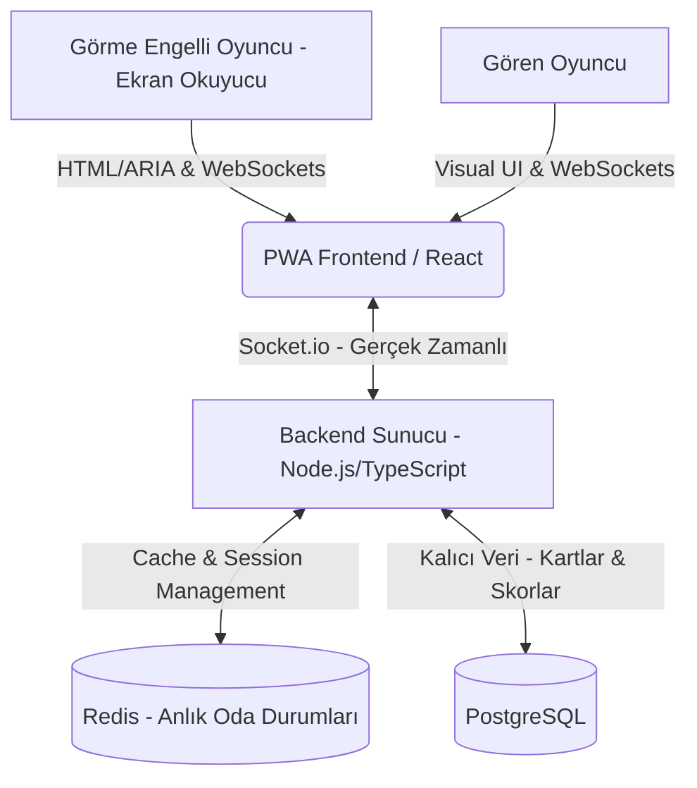

# ERİŞİLEBİLİR ÇOK OYUNCULU OYUN PLATFORMU
## Mimari Tasarım ve Teknoloji Seçenekleri Analizi

Bu döküman; görme engelli ve gören bireylerin bir arada, eş zamanlı ve engelsiz bir şekilde oynayabileceği çok oyunculu web tabanlı oyun platformunun (ilk oyun: **Tabu**) mimari tasarımını, erişilebilirlik (A11y) standartlarını ve teknoloji alternatiflerinin detaylı analizini sunmaktadır.

---

## 1. Proje Hedefleri ve Temel Gereksinimler

*   **Erişilebilirlik (A11y - WCAG 2.2 AAA):** Platform, ekran okuyucu (Screen Reader - NVDA, JAWS, VoiceOver, TalkBack) kullanan görme engelli bireyler ile gören bireylerin hiçbir dezavantaj yaşamadan aynı oyun odasında yarışabilmesini sağlamalıdır.
*   **Gerçek Zamanlı (Real-time) Çok Oyunculu Altyapı:** Tabu gibi hızlı tepki gerektiren oyunlarda odalar, oyuncu durumları, süreler ve skorlar anlık olarak senkronize edilmelidir.
*   **Modülerlik ve Genişletilebilirlik:** Sistem, gelecekte eklenecek yeni oyunlara (örn. Satranç, Kelime Oyunları, Kart Oyunları) kolayca adapte edilebilecek ortak bir "Lobi", "Oyuncu" ve "Oda" yönetim modülüne sahip olmalıdır.
*   **PWA ve Cross-Platform Desteği:** Sistem web tabanlı başlayacak, ancak mobil cihazlarda uygulama gibi kurulabilmesi için PWA (Progressive Web App) standartlarına uygun tasarlanacaktır.
*   **Çok Dilli Yerelleştirme (i18n):** Tabu kartları ve arayüz elemanları dinamik dil desteğine sahip olmalıdır.

---

## 2. Sistem Mimarisi Genel Bakış

Platform, **İstemci-Sunucu (Client-Server)** mimarisinde çalışacaktır. Anlık veri akışı için iki yönlü sürekli açık bir iletişim kanalı kurulacaktır.



---

## 3. Teknoloji Alternatifleri ve Detaylı Dil Analizi

Backend ve gerçek zamanlı oyun motoru için değerlendirilen 3 ana dili ve teknolojiyi, kodlama deneyimi olmayan veya az olan bir geliştiricinin de rahatça anlayabileceği şekilde artı ve eksileriyle aşağıda detaylandırılmıştır.

### ALTERNATİF 1: Node.js (JavaScript / TypeScript) — *Tavsiye Edilen*
Node.js, tarayıcılarda çalışan JavaScript dilinin sunucu tarafında da çalıştırılmasını sağlayan bir çalışma ortamıdır (runtime).

*   **Çalışma Mantığı:** Tek bir ana iş parçacığı (single-threaded) üzerinden asenkron olay döngüsü (Event Loop) ile çalışır. Yani gelen istekleri sırayla kuyruğa alır ancak diske yazma veya veritabanı sorgusu gibi bekleme gerektiren işleri arka plana atıp hemen bir sonraki isteğe geçer.
*   **Artıları:**
    *   **Tek Dil (JavaScript/TypeScript):** Hem ön yüzü (Frontend) hem de arka yüzü (Backend) aynı dil ile yazarsınız. Bu, kod paylaşımını kolaylaştırır ve geliştirme hızını 2 katına çıkarır.
    *   **Devasa Ekosistem (NPM):** Dünyanın en büyük kütüphane havuzuna sahiptir. Çok oyunculu sistemler için geliştirilmiş `Socket.io` kütüphanesi sayesinde bağlantı kopmaları, odalar arası mesajlaşma ve ölçekleme hazır olarak gelir.
    *   **Kolay Geliştirici Bulma:** JavaScript dünyada en çok bilinen dildir. Projeye yeni birini dahil etmek çok kolaydır.
*   **Eksileri:**
    *   **CPU Yoğun İşlerde Tıkanma:** Ağır matematiksel hesaplamalar yapıldığında tek bir iş parçacığı çalıştığı için diğer tüm kullanıcıları bekletebilir. (Annak Tabu gibi metin tabanlı oyunlarda bu bir sorun teşkil etmez).
    *   **Tip Güvenliği Eksikliği:** Standart JavaScript hataları çalışma anında (runtime) verir. Bu yüzden mimaride **TypeScript** kullanılarak bu eksi kapatılır.

### ALTERNATİF 2: Go (Golang)
Google tarafından geliştirilen, doğrudan makine koduna derlenen (compiled) ve yüksek performans hedefleyen modern bir sistem dilidir.

*   **Çalışma Mantığı:** Eşzamanlılığı (Concurrency) dilin çekirdeğinde barındırır. `Goroutines` adı verilen çok hafif sanal iş parçacıkları sayesinde, sunucu üzerinde milyonlarca bağımsız işlemi aynı anda çok düşük RAM kullanarak çalıştırabilir.
*   **Artıları:**
    *   **İnanılmaz Hız ve Düşük RAM:** C/C++ dillerine yakın performans gösterir. Sunucu maliyetleri Node.js'e göre oldukça düşüktür.
    *   **Güçlü Tip Sistemi ve Derleme:** Hatalar daha kod derlenirken (çalıştırılmadan önce) yakalanır. Güvenli ve stabil kod üretir.
    *   **Statik Derleme:** Sunucuya yüklerken sadece tek bir çalıştırılabilir dosya (binary) taşımak yeterlidir. Kurulumu çok basittir.
*   **Eksileri:**
    *   **Daha Uzun Kod Yazımı (Verbose):** Node.js'te 5 satırda yazılan bir Socket.io odası Go'da 30-40 satır sürebilir. Hazır oyun kütüphaneleri azdır.
    *   **Öğrenme Eğrisi:** İşaretçiler (pointers) ve katı kuralları nedeniyle öğrenmesi Node.js'e göre daha zordur.
    *   **Ayrı Dil Dünyası:** Ön yüzde yazılan kodlardan tamamen bağımsız bir dil yapısı kurulmalıdır.

### ALTERNATİF 3: Elixir (Phoenix Framework)
Erlang sanal makinesi (BEAM) üzerinde çalışan, fonksiyonel (functional) bir programlama dilidir. Özellikle telekomünikasyon sistemleri ve milyonlarca kişinin aynı anda bağlandığı sohbet/oyun uygulamaları için tasarlanmıştır.

*   **Çalışma Mantığı:** Nesne yönelimli değildir. Veriler değiştirilemez (immutable). Her kullanıcı bağlantısı tamamen izole edilmiş mini bir "proses" olarak çalışır. Bir proseste hata oluşursa sistemin geri kalanı asla etkilenmez.
*   **Artıları:**
    *   **Kusursuz Hata Toleransı:** Bir odadaki kod çökerse sunucu kapanmaz, sadece o oda yeniden başlatılır. Diğer binlerce aktif oyun kesintisiz devam eder.
    *   **Anlık İletişim Gücü (Phoenix Channels):** Ekstra Redis veya kuyruk mekanizmasına ihtiyaç duymadan milyonlarca canlı bağlantıyı yatayda ve dikeyde yönetebilir.
    *   **LiveView Teknolojisi:** İstenirse hiç JavaScript yazmadan doğrudan sunucu üzerinden erişilebilir dinamik sayfalar render edebilir.
*   **Eksileri:**
    *   **Çok Dik Geliştirici Eğrisi:** Fonksiyonel programlama mantığı alışılagelmiş programlama dillerinden (JS, Python, C#) tamamen farklıdır. Kod okuması ve yazması başlangıçta zordur.
    *   **Ekosistem Küçüklüğü:** Kütüphane sayısı Node.js'e kıyasla oldukça azdır. Özel bir erişilebilirlik entegrasyonu gerektiğinde sıfırdan yazmak gerekebilir.
    *   **İş Gücü Kısıtlılığı:** Türkiye'de ve dünyada Elixir bilen yazılımcı bulmak ve ekibi büyütmek oldukça zordur.

---

## 4. Erişilebilirlik (A11y) Mimarisi Detayları

Platformun WCAG 2.2 standartlarına göre görme engelli bireyler için nasıl tasarlanacağı aşağıda açıklanmıştır:

### A. Ekran Okuyucu ve Odak Yönetimi (Focus Management)
Ekran okuyucu kullanan bir oyuncunun kafasının karışmaması için sayfa üzerindeki odak (focus) dinamik olarak kontrol edilmelidir.

1.  **Sıra Geçişlerinde Odak Taşıma:** Sıra bir oyuncuya geldiğinde, ekran okuyucunun odağı doğrudan anlatması veya tahmin etmesi gereken kelimelerin olduğu alana (kart alanına) programatik olarak taşınacaktır (`element.focus()`).
2.  **Modallar ve Dialog Kutuları:** Yeni bir oyun odası kurulduğunda veya oyun bittiğinde açılan modallarda odak, modal dışına çıkamayacak şekilde kilitlenecektir (Focus Trap).
3.  **Hiyerarşik Başlıklar (Headings):** Sayfa yapısı `<h1>`dan `<h6>`ya kadar mantıksal bir sırada olmalıdır. Ekran okuyucu kullanıcıları sayfayı başlıklar arası zıplayarak okurlar.

### B. Anlık Bildirimler (ARIA Live Regions)
Oyun anında görsel olarak değişen bilgilerin (örneğin kalan süre veya skor artışı) görme engelliye sesli okunması gerekir. Bunun için HTML elementlerine `aria-live` niteliği eklenir:

```html
<!-- Skor Değişikliği (Polite): Kullanıcının o anki işlemini bölmeden, 
     ekran okuyucu boşta kaldığı an okur -->
<div aria-live="polite" id="score-board">
  Skor: 3 - 2
</div>

<!-- Kalan Süre Uyarısı (Assertive): Kritik durumlarda ekran okuyucuyu 
     hemen bölerek uyarır -->
<div aria-live="assertive" id="timer-announcer">
  Son 10 saniye!
</div>
```

### C. Klavye ile Tam Kontrol (Keyboard Navigation)
Görme engelliler mouse kullanmazlar. Tüm oyun akışı sadece klavye (`Tab`, `Enter`, `Space` ve yön tuşları) ile yönetilebilmelidir.
*   Tüm interaktif ögeler `<button>` veya `<a>` gibi semantik etiketlerle kurulacak, özel div'lere tıklandığında çalışan yapılardan kaçınılacaktır.
*   Odaklanan her butonun etrafında belirgin bir odak çerçevesi (focus indicator) bulunacaktır.

---

## 5. Yerelleştirme (i18n) Mimarisi

Çok dilli yapı iki seviyeli kurulacaktır:

1.  **Arayüz Yerelleştirmesi:** Butonlar, hata mesajları, yönlendirmeler ön yüzde JSON dosyalarında tutulacaktır (`tr.json`, `en.json`). Tarayıcı diline göre otomatik yüklenecektir.
2.  **Oyun Verisi Yerelleştirmesi (Tabu Kartları):** PostgreSQL veritabanında her dil için kartlar ilişkisel şemada saklanacaktır.

### PostgreSQL Kart Veritabanı Şeması Tasarımı:

```sql
-- Ana Kelime Tablosu
CREATE TABLE taboo_words (
    id SERIAL PRIMARY KEY,
    language_code VARCHAR(5) NOT NULL, -- 'tr', 'en', 'de' vb.
    target_word VARCHAR(100) NOT NULL, -- Anlatılacak kelime (örn: "Kitap")
    created_at TIMESTAMP DEFAULT CURRENT_TIMESTAMP
);

-- Yasaklı Kelimeler Tablosu (Her ana kelimenin 5 adet yasaklı kelimesi vardır)
CREATE TABLE forbidden_words (
    id SERIAL PRIMARY KEY,
    word_id INT REFERENCES taboo_words(id) ON DELETE CASCADE,
    forbidden_word VARCHAR(100) NOT NULL -- Yasaklı kelimeler (örn: "Okumak", "Sayfa", "Kütüphane")
);
```

---

## 6. Veritabanı ve Bellek Tasarımı

Çok oyunculu sistemlerde veri iki katmanlı yönetilir:

### 1. Bellek İçi Veritabanı (Redis - Hızlı ve Geçici Durumlar)
Oyun sırasında saniyede onlarca kez değişen durumları (oyuncunun odadaki konumu, kalan süre, güncel skor) diske yazmak sistemi yavaşlatır. Bu yüzden bu veriler RAM üzerinde çalışan **Redis**'te tutulur.
*   **Oda Bilgisi:** `room:12345` anahtarı altında oyuncu listesi, aktif anlatan oyuncu, turun bitiş zamanı saklanır.
*   **Lobi Eşleşmeleri:** Bekleyen oyuncular Redis listelerinde (Queue) hızlıca eşleştirilir.

### 2. İlişkisel Veritabanı (PostgreSQL - Kalıcı Durumlar)
*   Kullanıcı profilleri, giriş bilgileri.
*   Genel liderlik tabloları ve oyuncu istatistikleri.
*   Tabu kelime havuzu.

---

## 7. Sonuç ve Önerilen Yol Haritası

Projeye hızlı başlamak, erişilebilirlik standartlarını en kolay şekilde uygulamak ve gelecekte kolayca PWA mobil uygulamaya dönüştürebilmek için aşağıdaki yığın önerilmektedir:

1.  **Frontend:** Next.js (React) + TailwindCSS (A11y dostu hazır yapılar ve ekran okuyucu uyumluluğu için en geniş komüniteye sahip ekosistem).
2.  **Backend:** Node.js (TypeScript) + Express + Socket.io (Çoklu oyuncu gerçek zamanlı bağlantı yönetimi için öğrenmesi ve uygulaması en hızlı model).
3.  **Database:** PostgreSQL (Kart havuzu ve kullanıcılar için) + Redis (Aktif oyun odaları için).

Bu mimari, platform büyüdüğünde ve binlerce anlık oyuncuya ulaştığında, Socket.io sunucularını araya bir Redis Adapter koyarak kolayca yatayda ölçeklememize (birden fazla sunucu açmaya) olanak tanır.
